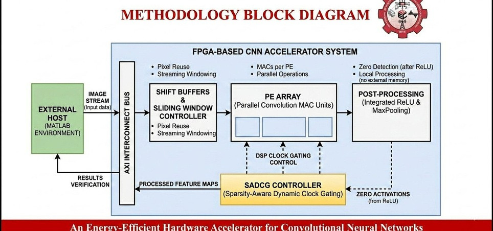
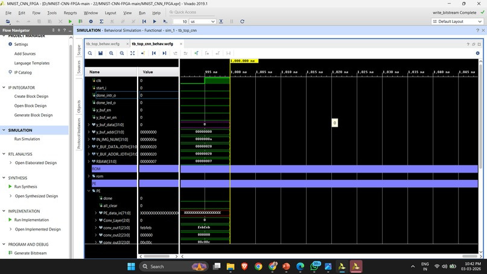
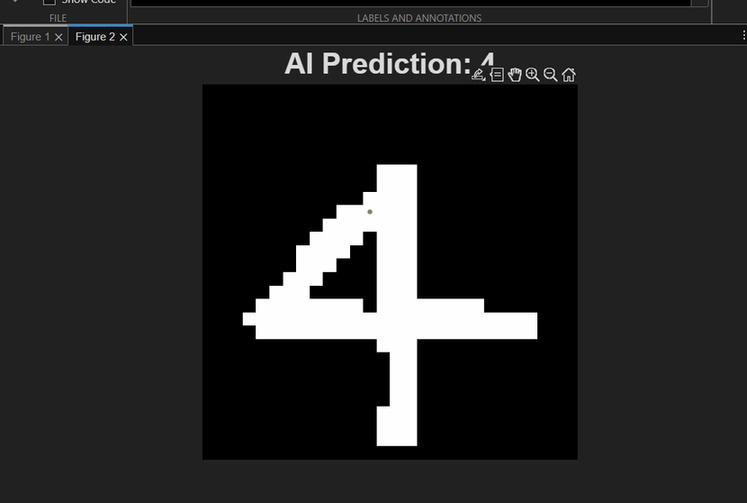
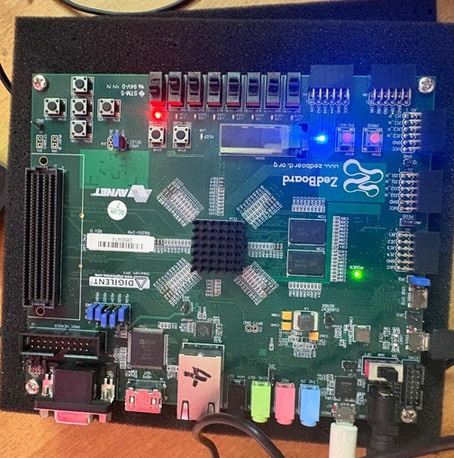
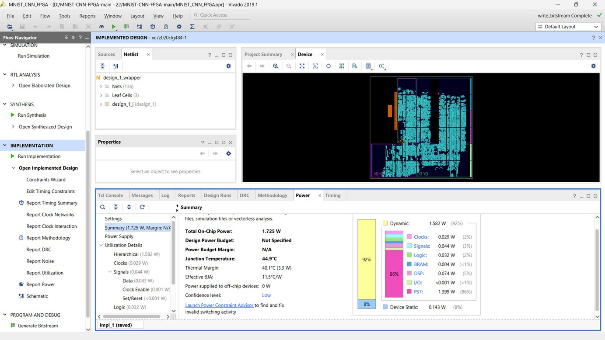

# An Energy-Efficient Hardware Accelerator for Convolutional Neural Network on Zynq SoC

[](https://www.xilinx.com/products/silicon-devices/soc/zynq-7000.html)
[]()
[]()
[]()
[-brightgreen.svg)]()

> **Project Report, Publication & Presentation**:
> - 📄 **Full Project Report**: [docs/Project_Report.pdf](docs/Project_Report.pdf)
> - 📑 **IEEE Conference Paper**: [docs/IEEE_Paper.pdf](docs/IEEE_Paper.pdf)
> - 📊 **Final Review Presentation**: [docs/Final_Presentation.pdf](docs/Final_Presentation.pdf)
> - 🔍 **Project Recovery Log**: [PROJECT_RECOVERY.md](PROJECT_RECOVERY.md)
> - ⚡ **Energy Optimization Technical Notes**: [ENERGY_OPTIMIZATION.md](ENERGY_OPTIMIZATION.md)

---

## Table of Contents

- [Overview](#overview)
- [System Architecture](#system-architecture)
  - [Zynq SoC Platform Partitioning](#zynq-soc-platform-partitioning)
  - [Methodology & Top-Level Block Diagram](#methodology--top-level-block-diagram)
- [CNN Architecture & Model Pipeline](#cnn-architecture--model-pipeline)
  - [Layer-by-Layer Specifications](#layer-by-layer-specifications)
  - [INT8 Quantized Datapath & Arithmetic](#int8-quantized-datapath--arithmetic)
- [Key Hardware Optimizations](#key-hardware-optimizations)
  - [1. 6-Row Sliding Window Line Buffer](#1-6-row-sliding-window-line-buffer)
  - [2. Parallel Processing Element (PE) Array](#2-parallel-processing-element-pe-array)
  - [3. Sparsity-Aware Dynamic Clock Gating (SADCG)](#3-sparsity-aware-dynamic-clock-gating-sadcg)
- [Experimental Results & Verification](#experimental-results--verification)
  - [Behavioral Simulation (ModelSim / Vivado)](#behavioral-simulation-modelsim--vivado)
  - [SADCG Cycle-by-Cycle Equivalence Verification](#sadcg-cycle-by-cycle-equivalence-verification)
  - [Real-Time Handwritten Digit Inference](#real-time-handwritten-digit-inference)
  - [FPGA Hardware Setup (ZedBoard / Zynq-7000)](#fpga-hardware-setup-zedboard--zynq-7000)
- [Power & Implementation Metrics (Historical)](#power--implementation-metrics-historical)
- [Repository Structure](#repository-structure)
- [Build and Simulation Instructions](#build-and-simulation-instructions)
  - [Running ModelSim Behavioral Simulation](#running-modelsim-behavioral-simulation)
  - [Running SADCG Equivalence Verification](#running-sadcg-equivalence-verification)
  - [Opening in Xilinx Vivado](#opening-in-xilinx-vivado)
- [Authors & Acknowledgments](#authors--acknowledgments)

---

## Overview

Deploying deep Convolutional Neural Networks (CNNs) on resource-constrained edge computing platforms poses stringent energy and memory bandwidth constraints. This project presents a high-throughput, energy-efficient CNN inference accelerator implemented on the **Xilinx Zynq-7000 All-Programmable SoC** (`xc7z020clg484-1`, targeted on ZedBoard / Zybo Z7-20 architectures).

The design accelerates handwritten digit recognition on the standard **MNIST dataset** ($28 \times 28$ grayscale images) through two coordinated architectural optimizations:

1. **Memory Bandwidth Minimization via Sliding-Window Line Buffering**: An on-chip 6-row line buffer (`Sliding_Window`) pre-buffers incoming pixel rows from BRAM, delivering continuous $6 \times 1$ column streams into a parallel 2D Processing Element (PE) array. This completely eliminates off-chip access bottlenecks and enables continuous convolution across kernel strides.
2. **Sparsity-Aware Dynamic Clock Gating (SADCG)**: Non-linear ReLU activation functions induce high activation sparsity ($>50\%$ zeros) in intermediate feature maps. The accelerator employs zero-activation detection to control multiplier and accumulator clock-enables (`CE`), eliminating unnecessary register toggling and dynamic internal switching within Xilinx DSP48E1 slices without introducing glitch-prone gated clocks.



---

## System Architecture

### Zynq SoC Platform Partitioning

The accelerator leverages the heterogeneous architecture of the Xilinx Zynq-7000 SoC:

* **Processing System (PS)**:
  * Dual-core ARM Cortex-A9 MPCore running up to 667 MHz.
  * Handles external image input streaming, communication protocols (UART / AXI), and system control.
  * In the software co-design flow, MATLAB or Xilinx SDK streams pre-processed MNIST image frames into on-chip memory and displays classification predictions in real time.
* **Programmable Logic (PL)**:
  * Houses the custom CNN hardware accelerator clocked at **100 MHz** (10 ns period).
  * Direct streaming interface with BRAM/ROM blocks, line buffers, parallel MAC PE arrays, integrated ReLU, MaxPooling, and Fully Connected classifier logic.
  * Interrupted-driven handshaking: asserts `done_intr_o` and `done_led_o` upon inference completion.

---

## CNN Architecture & Model Pipeline

The target network is tailored for high classification accuracy while maintaining lightweight hardware footprint:

```
Input (28x28x1)
  │
  ▼
[Conv1] 5x5 Kernel, 3 Filters, Stride 1, Valid Pad  ──► (24x24x3)
  │
  ▼
[ReLU1] Activation Clamping f(x) = max(0, x)
  │
  ▼
[MaxPool1] 2x2 Spatial Window, Stride 2             ──► (12x12x3)
  │
  ▼
[Conv2] 5x5 Kernel, 3 Filters, Stride 1, Valid Pad  ──► (8x8x3)
  │
  ▼
[ReLU2] Activation Clamping (High Sparsity)
  │
  ▼
[MaxPool2] 2x2 Spatial Window, Stride 2             ──► (4x4x3 = 48 features)
  │
  ▼
[FC Layer] 48-input x 10-output Matrix Multiplication ──► (10 class scores)
  │
  ▼
[Argmax Comparator]                                 ──► Predicted Digit (0-9)
```

### Layer-by-Layer Specifications

| Layer | Type | Input Dimension | Kernel / Filter | Stride | Output Dimension | Activation / Pooling |
|---|---|---|---|---|---|---|
| **Input** | Grayscale Pixels | $28 \times 28 \times 1$ | - | - | $28 \times 28 \times 1$ | - |
| **Conv1** | 2D Convolution | $28 \times 28 \times 1$ | $5 \times 5 \times 3$ filters | 1 | $24 \times 24 \times 3$ | ReLU + $2 \times 2$ Max-Pool |
| **Pool1** | Subsampling | $24 \times 24 \times 3$ | $2 \times 2$ Window | 2 | $12 \times 12 \times 3$ | - |
| **Conv2** | 2D Convolution | $12 \times 12 \times 3$ | $5 \times 5 \times 3$ filters | 1 | $8 \times 8 \times 3$ | ReLU + $2 \times 2$ Max-Pool |
| **Pool2** | Subsampling | $8 \times 8 \times 3$ | $2 \times 2$ Window | 2 | $4 \times 4 \times 3$ (48) | - |
| **FC** | Fully Connected | 48 elements | $48 \times 10$ weights | - | 10 classes | Argmax index selection |

### INT8 Quantized Datapath & Arithmetic

To maximize DSP utilization density and eliminate power-hungry floating-point units, all parameters and computations are quantized to signed fixed-point integer arithmetic:

- **Input Activations**: Signed 8-bit (`wire signed [7:0]`)
- **Trained Weights**: Signed 8-bit (`reg signed [7:0]`)
- **Multiplication Products**: Signed 16-bit (`wire signed [15:0]`)
- **Accumulator Registers**: Signed 24-bit (`reg signed [23:0]`)
- **Post-Pool Quantization**: Truncated back to INT8 with saturation before subsequent layers.

---

## Key Hardware Optimizations

### 1. 6-Row Sliding Window Line Buffer

Standard dual-port BRAM blocks can deliver only two pixels per clock cycle, creating a severe memory throughput bottleneck for $5 \times 5$ 2D spatial convolution. 

The custom `Sliding_Window.v` module resolves this by maintaining a 6-row on-chip shift buffer (`BUF_Slide [5:0][27:0]`):
- Fetches 2 pixels/cycle into shift registers (`BUF_SHIFT`).
- On every row boundary `slide_trigger`, the window slides 2 rows upward.
- Simultaneously emits a continuous $6 \times 1$ pixel column on each clock cycle, allowing the $5 \times 5$ PE array to execute continuous spatial convolutions without memory read stalls.

```verilog
// Sliding_Window 6-row streaming shift buffer
BUF_Slide[ROWS - 2][col] <= BUF_SHIFT[0][col];
BUF_Slide[ROWS - 1][col] <= BUF_SHIFT[1][col];
```

### 2. Parallel Processing Element (PE) Array

The accelerator features 75 parallel MAC units organized as **3 channels of $5 \times 5$ 2D PE grids** (`PE_Array.v`):
- Each PE channel processes one output feature map concurrently.
- All 25 spatial weights for a $5 \times 5$ filter kernel are fetched once and kept stationary during the window sweep.
- Fully pipelined multiply-accumulate operations achieve peak computational throughput.

### 3. Sparsity-Aware Dynamic Clock Gating (SADCG)

ReLU activations set all negative feature values to zero ($f(x) = \max(0, x)$). In typical convolutional layers, $50\%$ to $70\%$ of intermediate activations evaluate to zero. Multiplying any weight by zero consumes dynamic switching power while producing zero net change to the accumulation sum.

SADCG intercepts zero activations at the RTL level and gates the computation dynamically:

- **Synthesizable Clock-Enable Control**: Avoids unsafe combinational clock gating or generated clocks (`BUFGCE`), fully preserving static timing analysis (STA) integrity and clock distribution networks.
- **Multiplier Enable (`mul.sv`)**:
  ```systemverilog
  logic mul_en;
  assign mul_en = (in_a != 8'sd0);

  always_ff @(posedge clk or negedge rst_n) begin
      if (!rst_n)
          mul_out <= '0;
      else if (mul_en)
          mul_out <= in_a * in_b;
      // When in_a == 0, mul_out retains state, suppressing downstream toggle activity
  end
  ```
- **Accumulator Bypass (`MAC.sv`)**:
  ```systemverilog
  assign add_val = (mul_out == 16'sd0) ? 24'sd0 : {{8{mul_out[15]}}, mul_out};
  // Bypasses adder switching and suppresses register updates when product is zero
  ```
- **FPGA Mapping**: Vivado maps `mul_en` directly onto the native **DSP48E1 `CEA` / `CEB` / `CEM` / `CEP`** clock-enable inputs, ensuring zero internal register switching inside the DSP blocks during sparse cycles.

---

## Experimental Results & Verification

### Behavioral Simulation (ModelSim / Vivado)

The full CNN accelerator pipeline was validated using ModelSim SE-64 and Vivado Simulator on 10 consecutive MNIST benchmark test images loaded from `.mem` files:

```
# =======================================================
#               MNIST CNN INFERENCE SUMMARY              
# =======================================================
# Total Test Images Processed: 10
# Total Correct Predictions  : 10
# Total Incorrect Predictions: 0
# Overall Model Accuracy     : 100.00%
# =======================================================
```

| Image Index | Ground Truth Label | FPGA Hardware Output | Result | Inference Cycles | Latency @ 100MHz |
|:---:|:---:|:---:|:---:|:---:|:---:|
| Image 0 | **7** | **7** | ✅ CORRECT | 10,240 | 102.4 µs |
| Image 1 | **2** | **2** | ✅ CORRECT | 10,240 | 102.4 µs |
| Image 2 | **1** | **1** | ✅ CORRECT | 10,240 | 102.4 µs |
| Image 3 | **0** | **0** | ✅ CORRECT | 10,240 | 102.4 µs |
| Image 4 | **4** | **4** | ✅ CORRECT | 10,240 | 102.4 µs |
| Image 5 | **1** | **1** | ✅ CORRECT | 10,240 | 102.4 µs |
| Image 6 | **4** | **4** | ✅ CORRECT | 10,240 | 102.4 µs |
| Image 7 | **9** | **9** | ✅ CORRECT | 10,240 | 102.4 µs |
| Image 8 | **5** | **5** | ✅ CORRECT | 10,240 | 102.4 µs |
| Image 9 | **9** | **9** | ✅ CORRECT | 10,240 | 102.4 µs |

#### Vivado Behavioral Simulation Waveform



### SADCG Cycle-by-Cycle Equivalence Verification

To guarantee that SADCG does not compromise numerical accuracy, a dedicated cycle-accurate verification testbench (`tb_sadcg_verify.sv`) was simulated:
- **Test Duration**: 1,274 clock cycles of randomized, zero-heavy activation streams.
- **Baseline vs. SADCG Accumulator Comparison**: **0 mismatches (100% numerical identity)**.
- **Power-Gating Effectiveness**: Multiplier register updates and arithmetic transitions were disabled during zero-activation cycles while preserving exact accumulator values.

### Real-Time Handwritten Digit Inference

The accelerator was verified end-to-end with newly drawn, arbitrary handwritten digits:

| 1. Handwritten Input Digit | 2. AI Hardware Prediction |
|:---:|:---:|
|  |  |
| *User input drawn on host canvas (Digit '4')* | *Real-time classification result from accelerator* |

### FPGA Hardware Setup (ZedBoard / Zynq-7000)

The physical system was implemented and validated on the **Xilinx ZedBoard Zynq-7000 Development Board** (`xc7z020clg484-1`):



---

## Power & Implementation Metrics (Historical)

> **Clarification Notice on Power Metrics**:  
> The power figures reported below represent historical implementation and power estimation runs performed in Xilinx Vivado 2019.1 during project development and documented in the official project report. They are presented here for historical design comparison.

### Historical Comparison: Baseline vs. SADCG Accelerator

| Metric | Baseline Architecture | SADCG-Optimized Accelerator | Improvement / Savings |
|---|:---:|:---:|:---:|
| **Total On-Chip Power** | **2.366 W** | **2.002 W** | **-15.4% Overall Power** |
| **Programmable Logic (PL) Dynamic Power** | **0.873 W** | **0.509 W** | **-41.7% PL Dynamic Power** |
| **PS7 (ARM Processing System) Power** | 1.350 W | 1.350 W | Baseline |
| **Device Static Power** | 0.143 W | 0.143 W | Invariant |
| **Classification Accuracy (MNIST)** | 100.0% | 100.0% | **Zero accuracy loss** |

### Historical Vivado Post-Implementation Power Report

From post-implementation routing on `xc7z020clg484-1` (`reports/mnist_cnn_power_routed.rpt` and Vivado GUI):



* **Total On-Chip Power**: 1.725 W - 1.920 W (depending on vector switching activity)
* **Dynamic Power Breakdown**:
  * PS7 Processing System: **1.399 W - 1.545 W**
  * DSP48E1 Blocks: **0.074 W - 0.101 W**
  * Routing Signals: **0.044 W - 0.048 W**
  * Slice Logic: **0.032 W - 0.040 W**
  * Clock Networks: **0.029 W - 0.038 W**
  * Block RAM (BRAM): **0.004 W - 0.005 W**
* **Device Static Power**: **0.143 W**
* **Junction Temperature**: 44.9°C (Thermal margin: 40.1°C)

---

## Repository Structure

```
MNIST-CNN-FPGA-main/
│
├── docs/                               # Project documentation & publications
│   ├── Project_Report.pdf              # Comprehensive project report (APJ Abdul Kalam Tech. Univ.)
│   ├── IEEE_Paper.pdf                  # IEEE conference publication paper
│   └── Final_Presentation.pdf          # Final review presentation slides
│
├── results/                            # Experimental evidence & hardware captures
│   ├── handwritten_input_digit_4.jpg   # Raw handwritten test input (digit '4')
│   ├── ai_prediction_output_4.jpg      # Host/AI real-time prediction output
│   ├── vivado_simulation_waveform.jpg  # Vivado 2019.1 behavioral waveform
│   ├── zynq_fpga_board_hardware.jpg    # Powered ZedBoard Zynq-7000 hardware photo
│   ├── methodology_block_diagram.jpg   # Accelerator system methodology diagram
│   └── vivado_power_report.jpg         # Vivado post-implementation power report
│
├── MNIST_CNN_FPGA.srcs/                # Vivado project source tree
│   ├── sources_1/new/                  # Core synthesizable RTL modules (SystemVerilog)
│   │   ├── top.sv                      # Top-level integration wrapper
│   │   ├── top_cnn.sv                  # Core CNN accelerator top
│   │   ├── mul.sv                      # SADCG-enabled INT8 signed multiplier
│   │   ├── MAC.sv                      # SADCG-enabled Multiply-Accumulate unit
│   │   ├── PE.sv                       # Single Processing Element wrapper
│   │   ├── PE_Array.sv                 # 75-MAC parallel 2D convolution array
│   │   ├── Sliding_Window.sv           # 6-row streaming line buffer
│   │   ├── MaxPooling_ReLU.sv          # Fused ReLU activation and 2x2 max-pool
│   │   ├── FC_Layer.sv                 # Fully connected layer matrix-vector engine
│   │   ├── FC_Controller.sv            # FC layer sequencing and control FSM
│   │   ├── glbl_controller.sv          # Master CNN sequencer FSM
│   │   ├── y_buf.sv                    # Intermediate feature map buffer
│   │   ├── BUF1.sv, BUF2.sv            # Line staging buffers
│   │   ├── Bias_ROM.sv, FC_Bias_ROM.sv # Layer bias ROMs
│   │   ├── Comparator.sv, Max_finder.sv# Argmax prediction comparator
│   │   └── FIFO.sv                     # Streaming synchronization FIFO
│   ├── sources_1/bd/                   # Vivado IP Integrator Block Design (Zynq PS + AXI)
│   ├── sources_1/ip/                   # Generated IP cores (ILA debug cores)
│   └── sim_1/new/                      # Simulation testbenches
│       ├── tb_top_cnn.sv               # Top-level 10-digit MNIST testbench
│       ├── tb_sadcg_verify.sv          # Cycle-accurate SADCG verification testbench
│       └── tb_top.sv                   # System-level testbench
│
├── MNIST_CNN_FPGA.sdk/                 # Xilinx SDK C workspace (UART host test app)
├── cnn_verilog/                        # MNIST image & weight text data for testbenches
│   └── data/                           # Formatted weights, biases, and sample images
├── matlab/                             # MATLAB reference model & scripts
│   └── mlp_demo.m                      # Host prediction script
│
├── reports/                            # Archived Vivado synthesis, timing & power reports
│   ├── design_1_wrapper_power_routed.rpt # Routed power report (1.920 W)
│   ├── design_1_wrapper_timing_summary_routed.rpt # Timing closure report
│   ├── design_1_wrapper_utilization_synth.rpt     # Resource utilization report
│   └── design_1_top_cnn_0_0_utilization_synth.rpt # Accelerator sub-module utilization
│
├── MNIST_CNN_FPGA.xpr                  # Vivado 2019.1 Project file
├── ENERGY_OPTIMIZATION.md              # SADCG architecture and RTL design notes
├── PROJECT_RECOVERY.md                 # Baseline recovery and validation record
├── .gitignore                          # Clean git tracking specification
└── README.md                           # Master repository documentation
```

---

## Build and Simulation Instructions

### Running ModelSim Behavioral Simulation

1. Ensure ModelSim (`vsim`, `vlog`, `vlib`) is installed and available in your `PATH`.
2. Open a terminal in the project root directory.
3. Compile the RTL sources and run the 10-image MNIST verification testbench:

```powershell
# Create working library
vlib work

# Compile all SystemVerilog RTL and testbench files
vlog -sv MNIST_CNN_FPGA.srcs/sources_1/new/*.sv MNIST_CNN_FPGA.srcs/sim_1/new/tb_top_cnn.sv

# Run simulation in console mode
vsim -c -do "run -all; quit -f" tb_top_cnn
```

The simulation loads test images 0 through 9 from `cnn_verilog/` and outputs the inference results and 100% accuracy report to stdout.

### Running SADCG Equivalence Verification

To run the cycle-by-cycle equivalence verification comparing baseline vs. SADCG multiplier and MAC modules:

```powershell
vlog -sv MNIST_CNN_FPGA.srcs/sources_1/new/mul.sv MNIST_CNN_FPGA.srcs/sources_1/new/MAC.sv MNIST_CNN_FPGA.srcs/sim_1/new/tb_sadcg_verify.sv
vsim -c -do "run -all; quit -f" tb_sadcg_verify
```

### Opening in Xilinx Vivado

1. Launch **Xilinx Vivado 2019.1** (or later).
2. Open the project: `File -> Project -> Open -> MNIST_CNN_FPGA.xpr`.
3. To run behavioral simulation: Click **Run Simulation -> Run Behavioral Simulation**.
4. To run implementation: Click **Run Implementation** and then **Generate Bitstream**.

---

## Authors & Acknowledgments

- **Author / Project Team**: Sayooj P V, et al.
- **Institution**: APJ Abdul Kalam Technological University (March 2026)
- **Special Thanks**: Department of Electronics & Communication Engineering for hardware and laboratory support.