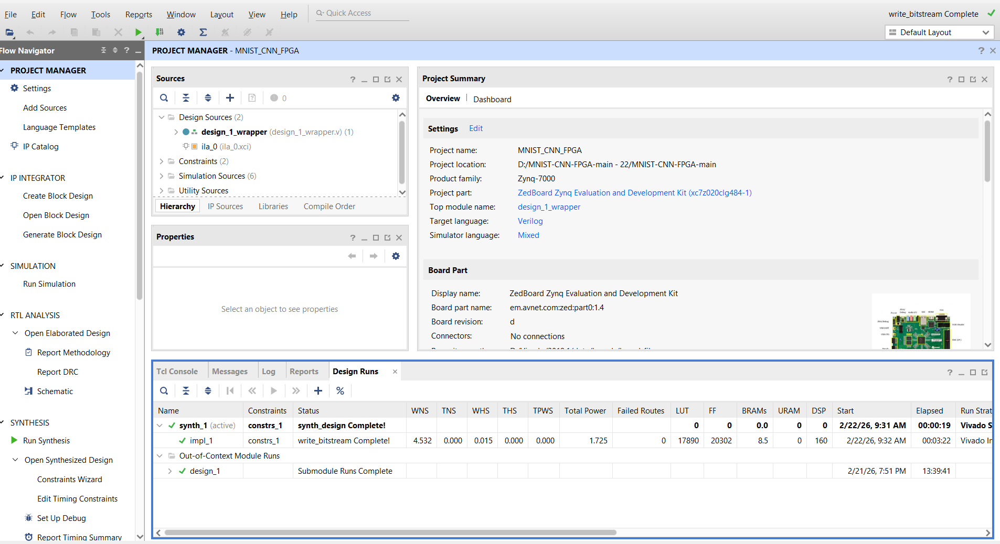
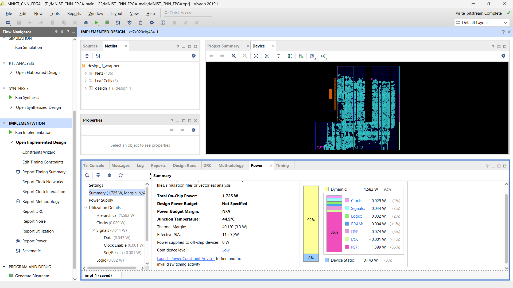
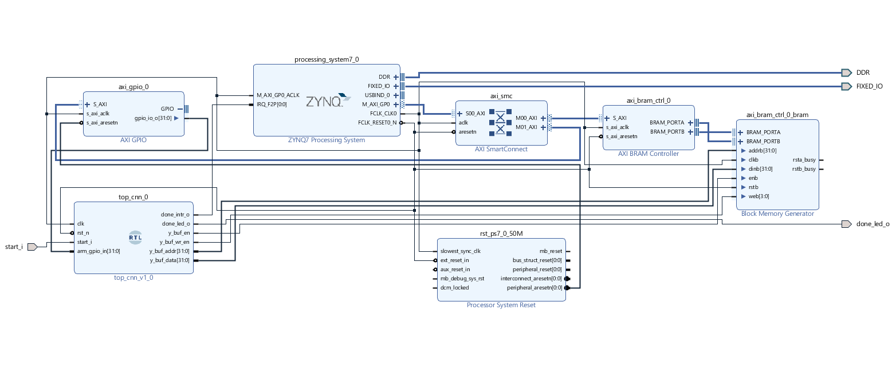
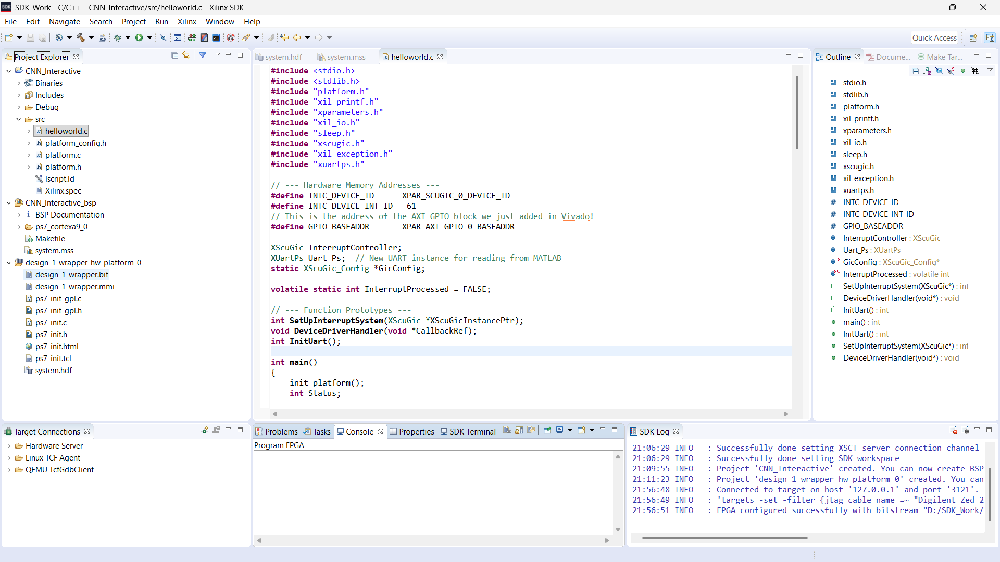
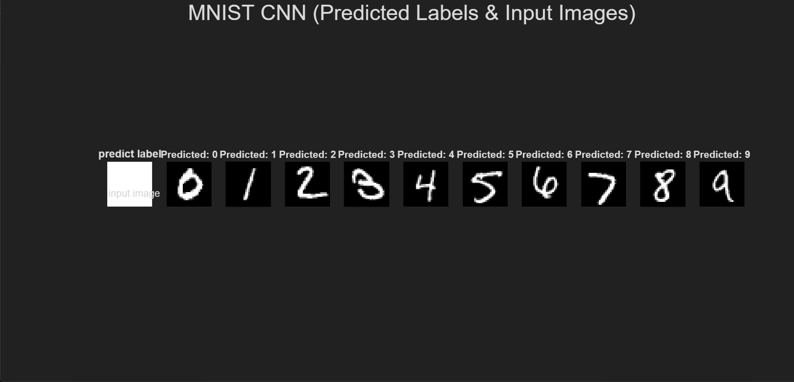
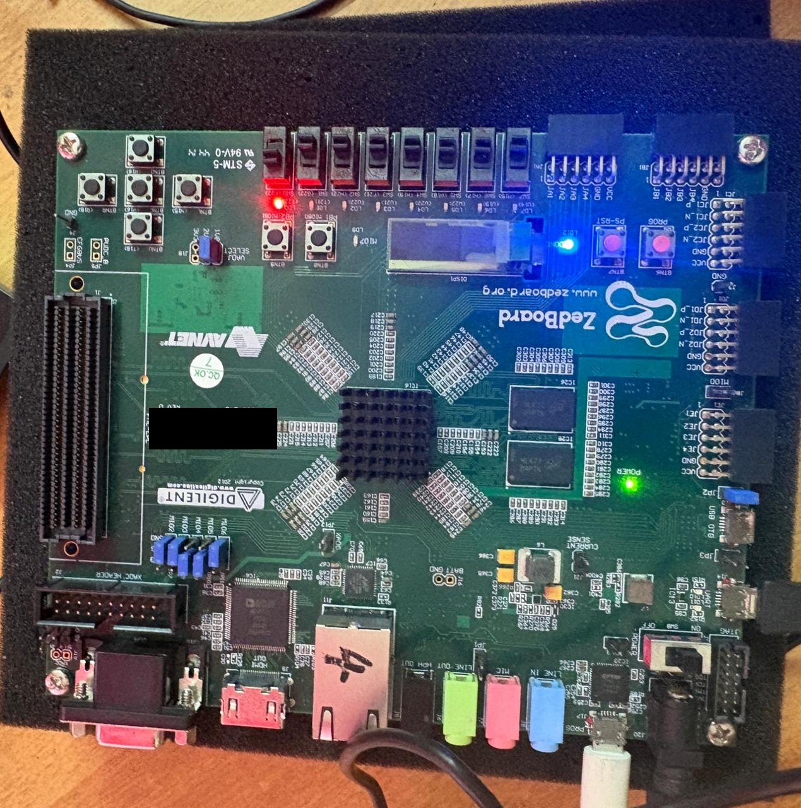
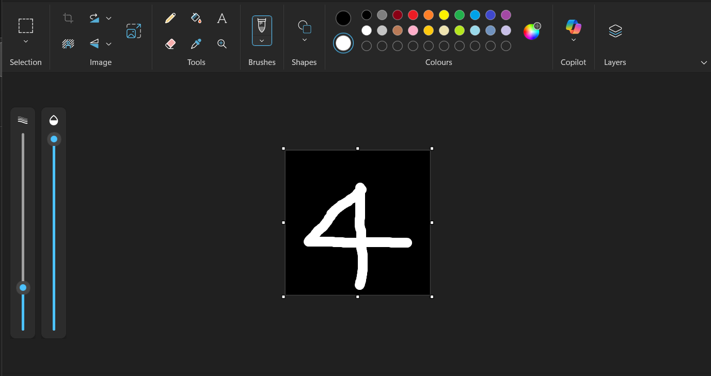
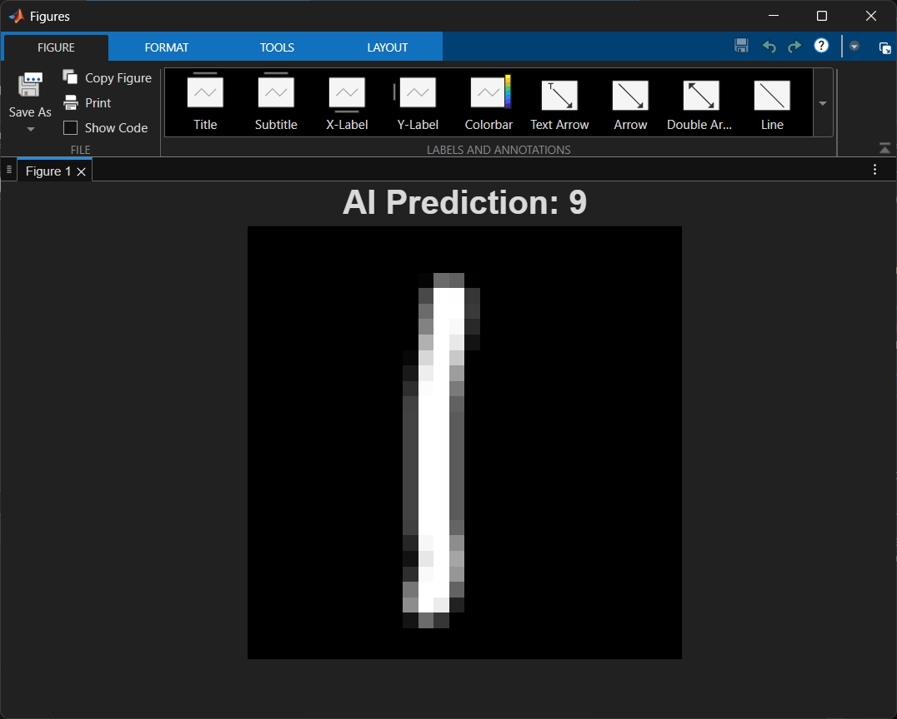
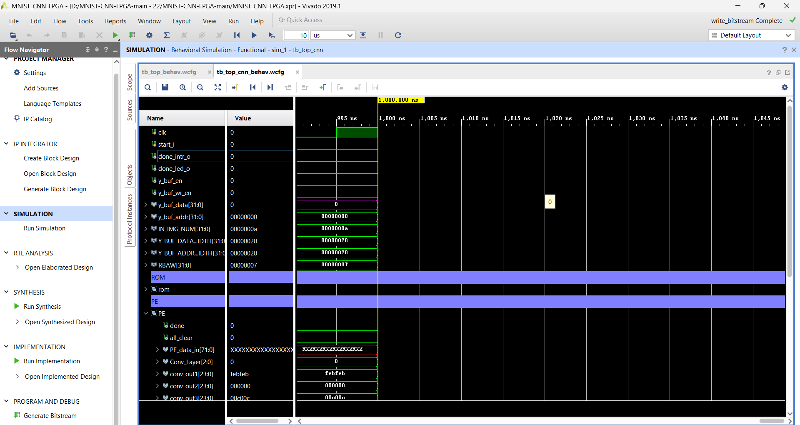

# MNIST CNN Accelerator on Zynq-7000: college mini-project record

A Verilog CNN accelerator for MNIST handwritten-digit classification on a
Xilinx Zynq-7000 (XC7Z020). The ARM processing system (PS) collects results over
AXI and sends them to MATLAB over UART.

> **Read this first: provenance.**
> This repository is an honest record, not the original working tree.
>
> * The accelerator RTL, block design, SDK code and MATLAB script come from the
>   open-source project **[foodinsect/MNIST-CNN-FPGA](https://github.com/foodinsect/MNIST-CNN-FPGA)**
>   (MIT licence, © 2024 Hoooo), originally built for the Digilent Zybo Z7-20.
> * For our March 2026 mini-project we **retargeted that design to an Avnet
>   ZedBoard**, added an AXI GPIO input path and an interactive single-digit
>   demo, implemented it in Vivado 2019.1 and ran it on the board.
>   **Those modified project files were later deleted.** What survives is
>   screenshots, a photo and the college documents (see [Evidence](#evidence)).
> * In September 2026 this repository was rebuilt from a fresh download of the
>   upstream project with Google Antigravity (AI assistant). That session also
>   wrote the "SADCG" energy-optimisation code. An audit in November 2026
>   (Claude Code) showed that code changes nothing measurable.
>
> Full details: [`docs/RECOVERY_REPORT.md`](docs/RECOVERY_REPORT.md) ·
> per-file classification: [`PROJECT_RECOVERY.md`](PROJECT_RECOVERY.md).

## Project

*An Energy-Efficient Hardware Accelerator for Convolutional Neural Network on
Zynq SoC*: B.Tech ECE mini-project, Team 06 (2023–27 batch), Muthoot Institute
of Technology and Science, March 2026. Team: Adith M, Anandhakrishnan M,
Benison P Baby, Sayooj P V. Guides: Ms Deepa Prabhu, Ms Nayana P K.
Documents: [report](docs/Project_Report.pdf) · [IEEE-format paper](docs/IEEE_Paper.pdf) ·
[final review presentation](docs/Final_Presentation.pdf).

## What is established

| | Status | Evidence |
|---|---|---|
| Design retargeted to ZedBoard `xc7z020clg484-1` in Vivado 2019.1 | ✅ Original | screenshots 21 Feb, 9 Mar 2026 |
| Implementation + bitstream: LUT 17,890 · FF 20,302 · BRAM 8.5 · DSP 160 · WNS +4.532 ns | ✅ Original | [design runs](results/evidence/2026-03-09_vivado-design-runs-zedboard-bitstream-complete.png) |
| Vectorless power estimate **1.725 W** (PS7 1.399 W, PL dynamic ≈0.18 W, static 0.143 W; confidence *Low*) | ✅ Original | [power summary](results/evidence/2026-03-02_vivado-implemented-power-1.725W-xc7z020clg484.png) |
| Physical ZedBoard programmed over JTAG | ✅ Original | [SDK log](results/evidence/2026-02-21_sdk-cnn-interactive-jtag-fpga-configured.png), [photo](results/evidence/2026-03-21_zedboard-powered-photo.jpeg) |
| 10 stored test images classified 0–9, results shown in MATLAB via UART | ✅ Original (screenshot) | [MATLAB figure](results/evidence/2026-02-21_matlab-uart-predictions-0-to-9.png) |
| AXI GPIO + interactive single-digit demo (MS Paint → MATLAB "AI Prediction") | ✅ Original, ⚠️ source lost | [block design](results/evidence/2026-02-21_vivado-block-design-with-axi-gpio.png), [input](results/evidence/2026-03-21_mspaint-handwritten-input-4.png), [prediction "4"](results/evidence/2026-03-21_matlab-single-digit-prediction-4.png), [misprediction "1"→9](results/evidence/2026-02-21_matlab-single-digit-misprediction-1-as-9.png) |
| Whether the single-digit prediction was computed on the FPGA | ❓ Unverified | the code was not recovered |
| SADCG clock gating in the original design; 2.367 W → 2.002 W / "41 %" figures in report & paper | ❓ **Unverified**: no supporting evidence found | conflicts with the 1.725 W result and the unchanged 160-DSP count |
| RTL behavioural simulation of this repository (ModelSim, 10 images) | ✅ Reproduced Nov 2026 | [below](#simulation) |

## Architecture (as in this repository's RTL)

```
Zynq PS (ARM A9, bare-metal) ──AXI──► AXI BRAM ctrl ◄──► dual-port BRAM ◄── results (y_buf)
        ▲  IRQ 61 (done_intr_o)                                           │
        └────────── UART 115200 ──► MATLAB (mlp_demo.m)                   │
PL @ 50 MHz (clk_fpga_0):                                                 │
 image BRAM (10 × 28×28, preloaded) → 6-row sliding window → PE array ────┘
   conv1 5×5, 1→3 ch → ReLU + 2×2 max-pool → conv2 5×5, 3→3 ch → ReLU + pool
   → 48 features → FC 48→10 (10 MACs) → argmax → class 0–9
```

* **PE array:** 2 PEs × 3 channels, each with 25 multipliers = 150, plus 10 FC MACs = **160 multipliers = 160 DSP48E1**.
* **Precision:** 8-bit unsigned input pixels (zero-extended to 12 bit), 8-bit signed weights, 20-bit products, 20-bit adder tree (no bit growth). Conv1 cannot overflow with the shipped weights. Conv2 has not been analysed.
* **Clock:** the CNN runs on the PS fabric clock `clk_fpga_0` = **50 MHz**. The 125 MHz `sys_clk_pin` in the Zybo XDC applies to an unused pin. Testbenches use a 10 ns clock.
* **Images:** stored in BRAM at bitstream build time (`cnn_verilog/INT8_input_image_hex.txt`). In this repository's flow, MATLAB only receives and plots results.

## Two RTL copies: which one is real

| Path | Used by | Notes |
|---|---|---|
| `MNIST_CNN_FPGA.srcs/sources_1/imports/cnn/*.v` | **Vivado project (`.xpr`) synthesis/implementation** | Reference RTL; produced every Vivado result above |
| `MNIST_CNN_FPGA.srcs/sources_1/new/*.sv` | ModelSim flow only | A different revision of the upstream RTL; contains the Sep 2026 SADCG edits in `mul.sv`/`MAC.sv` |

## Simulation

Regression (ModelSim; verified with ModelSim-Altera Starter 10.1d on Windows):

```bash
cd sim/modelsim
vsim -c -do run_all.do
```

Results from 6 Nov 2026:

| Configuration | `tb_top_cnn` | `tb_top` | `tb_sadcg_verify` |
|---|---|---|---|
| Vivado source set (`imports/cnn/*.v`) | PASS: 0–9 | PASS: 0–9 | n/a |
| `new/*.sv` (with SADCG edits) | PASS: 0–9 | PASS: 0–9 | PASS (0 errors) |

The 10 stored images are the digits 0,1,…,9 in order, and the script checks the
captured outputs against that. If the repository sits in a very long Windows
path, set `MNIST_SIM_LIBDIR` to a short folder (see the script header).
In Vivado: open `MNIST_CNN_FPGA.xpr` (needs Vivado 2019.1 and Digilent board
files) and run behavioural simulation of `tb_top_cnn`. **Not re-verified in
2026-11** (no Vivado available).

## About SADCG

See [`ENERGY_OPTIMIZATION.md`](ENERGY_OPTIMIZATION.md). In short: the
September 2026 code writes 0 when an activation is 0, which is what the
multiplier would produce anyway. It infers no clock enable. A VCD comparison
shows **identical** toggle counts on all 160 multiplier registers. It is also
not in the Vivado source set. No power saving is claimed.

## Evidence

Copies of original screenshots and one photo. Seven are unmodified. For privacy, two are cropped (a chat window and the Windows taskbar removed) and the board photo has its serial sticker blacked out. The manifest lists their original file names,
hashes and what each does and does not prove:
[`results/evidence/EVIDENCE_MANIFEST.md`](results/evidence/EVIDENCE_MANIFEST.md).

| | |
|---|---|
|  ZedBoard implementation, bitstream complete (9 Mar 2026) |  Vectorless power 1.725 W (2 Mar 2026) |
|  Block design with the added AXI GPIO (lost) |  SDK: FPGA configured over a Digilent Zed JTAG cable |
|  10 stored images → 0–9 via UART |  ZedBoard, powered and configured |
|  Hand-drawn input |  MATLAB "AI Prediction: 4" |
|  A misprediction ("1" → 9) during testing |  Vivado behavioural sim (first 1 µs only) |

`reports/*.rpt` are the **upstream author's** Vivado reports (Zybo part, 12 May
2025: 1.920 W, WNS +0.023 ns). They are kept for reference and are not our
results. `results/methodology_block_diagram.jpg` is a conceptual slide from the
presentation.

## Repository layout

```
MNIST_CNN_FPGA.xpr / .srcs / .sdk   upstream Vivado 2019.1 project (Zybo Z7-20)
cnn_verilog/data/                   weights, biases, 10 test images, 1000-image vectors
matlab/mlp_demo.m                   UART result viewer (COM6, 115200)
reports/                            upstream reference Vivado reports
docs/                               report, paper, presentation, RECOVERY_REPORT.md
results/evidence/                   original screenshots + manifest
sim/                                ModelSim regression and toggle tools (2026-11)
```

`cnn_verilog/mnist/` (the unused 10,000-image MNIST test set, 10,003 files) was
removed from the working tree in Nov 2026. Restore it with
`git checkout f9cdfe3 -- cnn_verilog/mnist`.

## Not available

The team's modified RTL/block design/constraints, ZedBoard bitstream and reports,
interactive SDK and MATLAB code, any original SADCG implementation, training and
quantisation scripts, and the 1000-image testbench.

## Credits and licence

Accelerator design: © 2024 Hoooo ([foodinsect/MNIST-CNN-FPGA](https://github.com/foodinsect/MNIST-CNN-FPGA)), MIT licence (see `LICENSE`).
ZedBoard port, integration and testing: Team 06 (2026). Reconstruction (Sep 2026) used Google
Antigravity; the provenance audit (Nov 2026) used Claude Code.
